# Group meeting presentation-PPT

[简体中文](README.md) | [English](README.en.md)

> **Dear fellow students at Liaoning University — still dreading your weekly group meeting?**
> You read the paper, then spend the night translating, cropping figures, laying out slides and matching last week's style.
> This skill squeezes that repetitive work into a single sentence.

Turn a research paper into a **Chinese group-meeting report**, then reuse your own previous deck as the visual template
to produce a ready-to-present `.pptx`. Whether you work on machines, materials, medicine or literature,
a group meeting asks the same few questions — the template and rules stay the same.

It is an **Agent Skill** (`SKILL.md` convention): give it a paper PDF, DOI or plain text, and it produces the
five-module content; when you need the deck, it reuses your existing slides and auto-crops figures and tables from the PDF.

Not tied to a single client — **Claude Code, opencode, DeepSeek Harness, Doubao (豆包), Codex and any other agent
that supports `SKILL.md` can use it directly**. The scripts are plain Python, so they also run without any agent.

> If this skill saves you an evening, **a ⭐ Star** is the best way to say thanks.

---

## 🎯 What it solves

A group-meeting talk has to cover five things in **10–15 slides**: what the paper is, what the abstract says,
where the novelty is, how the experiments were run, and what the conclusions are.
Doing it by hand takes 2–3 hours: reading, translating, cropping figures, laying out, matching the old style.

This skill fixes the pipeline:

1. 📝 **Content** — five modules as plain Markdown (`## 模块X：…` becomes a slide title), ready to paste;
2. 🖼️ **Figures** — `Fig. 2` / `Table 5` cropped from the PDF at 400 dpi;
3. 🎨 **Layout** — copy your previous deck, replace text and figures, reorder pages;
4. 🔍 **Self-check** — export every slide to PNG, look for overflow, overlap and leftover text.

## ✨ Features

- 🧩 **Fixed five-module output**: paper info / abstract / novelty / experiments / conclusion.
- 💡 **Novelty = ideas only**: old problem → what they did → what it fixes → figure. No experimental numbers here.
- 🧭 **Framework slide first**: one page walking the full pipeline (input → preprocess → features → fusion → backbone → output), with swap-out points marked.
- 📊 **Experiments that match the tables**: best/worst numbers, the gap, which two classes get confused — not “works well”.
- 🔀 **Abstract/conclusion language is selectable**: Chinese or English for each, independently (4 combinations).
- 🚫 **No dataset? No problem**: theory/simulation/framework papers skip the dataset slide, and an “experimental setup” slide carries the reproducibility details.
- 🎨 **Reuse your own template**: `deckkit` duplicates slides, rewrites text, swaps figures, reorders pages.
- 🎛️ **Someone else's deck works too**: `adapt_template.py` labels title/body/caption/picture slots automatically.
- 🖼️ **Auto figure/table cropping**: `pdf_figs.py` finds table bounds from horizontal rules, so wide tables are captured whole.
- 🎓 **Works for any field**: the example is just a format demo — terms, metrics and datasets follow your paper.

## 📦 Install

Drop this folder into the skills directory of whichever agent you use (the folder name must match `name` in `SKILL.md`):

```bash
# macOS / Linux (default location for Claude Code, opencode, …)
git clone <this-repo> ~/.claude/skills/group-meeting-presentation-ppt

# Windows
git clone <this-repo> %USERPROFILE%\.claude\skills\group-meeting-presentation-ppt
```

Skills paths differ per client: for DeepSeek Harness, Doubao, Codex and others that support `SKILL.md`,
put this folder wherever their docs say skills/plugins live — nothing inside needs changing.
You can also use it purely as a script library:

```bash
git clone <this-repo>
cd group-meeting-presentation-ppt
python scripts/adapt_template.py template.pptx -o tpl_map.json   # no agent required
```

Dependencies (only needed to build the pptx):

```bash
pip install python-pptx PyMuPDF lxml
```

> PNG export for self-check uses PowerPoint COM (Windows) or LibreOffice (cross-platform) — optional.

**Tested on**: Windows 10/11, Python 3.12, `python-pptx 1.0`, `PyMuPDF 1.24`.
`pdf_figs.py`, `adapt_template.py` and `inspect_template.py` are cross-platform; only the PNG export step is easiest on Windows.

**⚠️ Model requirement: vision**

This skill reads the paper's figures — which two classes the confusion matrix mixes up, whether the curves converge,
whether t-SNE clusters separate, which block of the method figure maps to which module, and whether an exported slide
has overlapping text. All of that needs a **model that accepts image input**.

| Model | What you get |
|---|---|
| Vision-capable (GPT-4o / Claude / Gemini / DeepSeek-VL, …) | Full quality: numbers + figure-based conclusions + layout self-check |
| Text-only | Markdown, figure cropping and templating still work, but **it cannot see inside the figures**; captions rely on the paper text and you must verify them |

Workaround: draft content with a multimodal model, then polish formatting with a cheaper one — or send key figures
to a vision model separately and paste the answers back into the conversation.

## 🚀 Quick start

No commands, no flags — **open a chat, drop the paper in, ask in plain language**.

### 1. Hand over the paper

Any of these works (Claude Code / opencode / other agents):

- **Drag the PDF** into the chat window
- **Give a path or link**: `D:\papers\xxx.pdf`, DOI `10.1016/j.rcim.2026.103366`, arXiv URL
- **Paste the text**: Abstract / full text (without a PDF, figures can't be cropped)

### 2. Say what you want in one message

```
Make a group-meeting report for this paper, using the standard literature-review template
<drag the PDF in>
Presenter: Zhang San
Date: 2026-11-09
Abstract in Chinese, conclusion in Chinese
Use assets/template.pptx as the template
```

Anything missing gets asked:

| You left out | It asks |
|---|---|
| Abstract/conclusion language | Chinese or English? They can differ (CC / EE / CE / EC) |
| Presenter | Whose name goes on the cover? |
| Date | When is the talk? |
| Template | “Use your own uploaded deck, or the bundled `assets/template.pptx`?” — no upload means bundled |

### 3. What you get

- **Text only** — say “Markdown first”: `paper_文献阅读汇报稿.md` (five modules, one section per slide, ready to paste)
- **Finished deck** — say “build the pptx”: it crops figures at 400 dpi, adapts the template, duplicates and rewrites slides,
  exports every page to PNG for a self-check, and delivers `YYYY.MM.DD_shorttitle.pptx`

### 4. Not happy? Just say so

No code needed — keep talking:

```
Make the third novelty point more concrete, it reads like the abstract
Put Table 3 on the experiment slide, caption says “how to read it”
Change the cover date to 2026-11-16
This slide is too crowded, split it into two
```

Scripts also work standalone, without any agent:

```bash
python scripts/pdf_figs.py paper.pdf -o figs fig1="Fig. 1" tab2="Table 2"
python scripts/adapt_template.py my_template.pptx -o tpl_map.json
```

## 🧩 The five modules

| Module | Content | Notes |
|---|---|---|
| 1 Paper info | Title / affiliations / journal, volume, pages / DOI / presenter / date | Cover slide |
| 2 Abstract | **Two slides**: abstract only, then “problems + solutions” on the next slide | Faithful; red subheads, black body text |
| 3 Novelty | **Full-pipeline framework slide** + 2–4 novelty points | Ideas only, no numbers |
| 4 Experiments | Dataset (**optional**) → **experimental setup (always 1 slide)** → comparison → ablation | Four elements each, numbers traceable to tables |
| 5 Conclusion | Chinese translation (or original) | Sentence-by-sentence faithful |

Each novelty point (the three labels are bold + highlighted, body text stays black):

```
Old problem: how the prior method worked, where it broke, what the consequence was
What they did: the change + one plain-language sentence on the mechanism
What it fixes: the direct improvement over the flaw above
Figure: Figure X (which part of it)
```

On the slide:

- section header reads **创新点**, not “创新点/关键技术”
- slide titles read **创新点1：…… / 创新点2：……**; the framework slide reads “整体框架与全流程：……”
  and comes first, without taking a novelty number
- titles and body must clear the header band (title top ≥ 1.15 in) — **no overlapping text**

**About the dataset slide** — papers with their own or public datasets (fault diagnosis, imaging, remote sensing,
materials characterization…) get one slide. Purely theoretical, simulation-only, algorithm/framework and humanities
topics **skip it entirely**; never invent a dataset to fill the page.
The **experimental-setup slide is mandatory**: splits, key hyperparameters, training strategy, metrics and hardware,
so the audience can judge whether the results are trustworthy.

## 🖼️ Example

Based on **“Signal–text fusion multimodal large language model for few-shot fault diagnosis of industrial robots”**
(*Robotics and Computer-Integrated Manufacturing*, 2027, 103: 103366,
DOI: [10.1016/j.rcim.2026.103366](https://doi.org/10.1016/j.rcim.2026.103366)).
All seven slides below were generated by this skill (presenter and date shown as placeholders):

| Cover | Abstract (abstract only) |
|---|---|
| 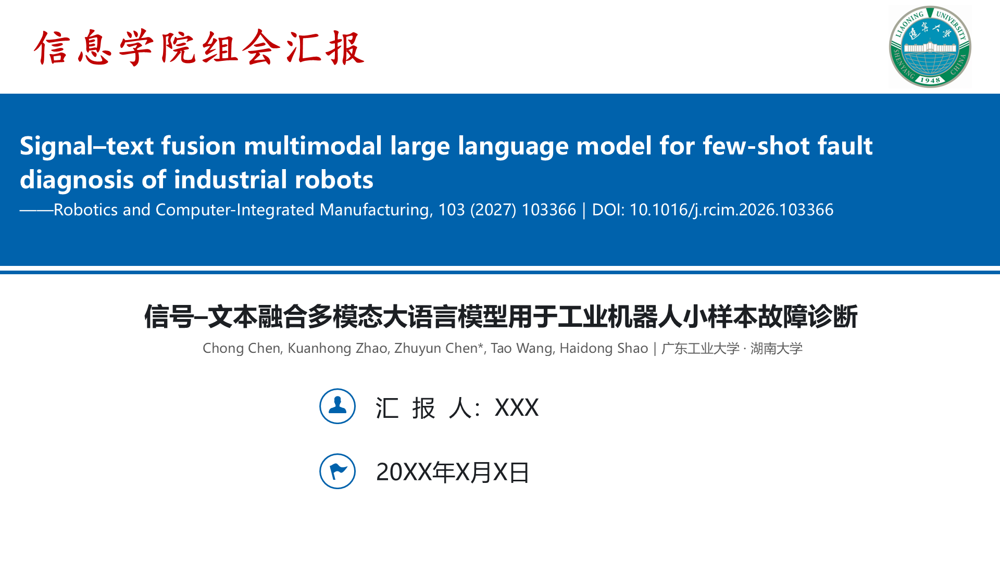 | 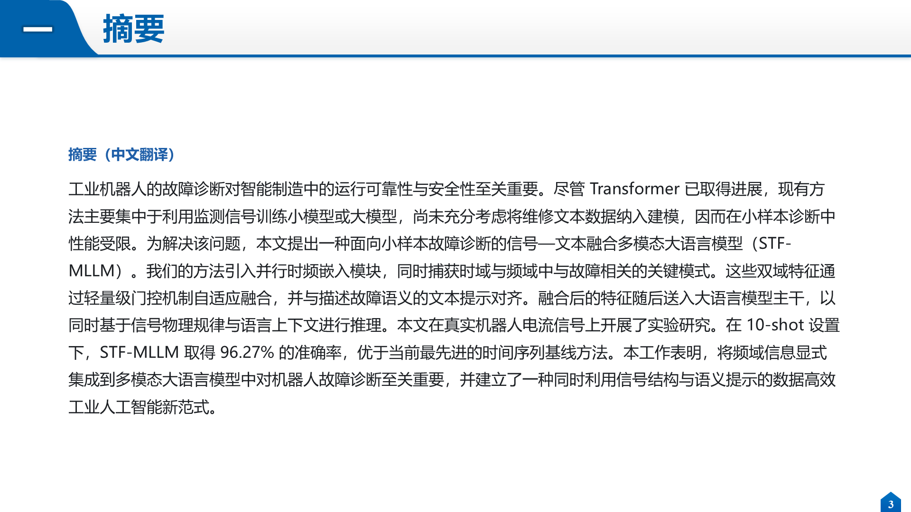 |
| **Problems / solutions (red subheads, black body)** | **Full pipeline (first novelty slide)** |
| 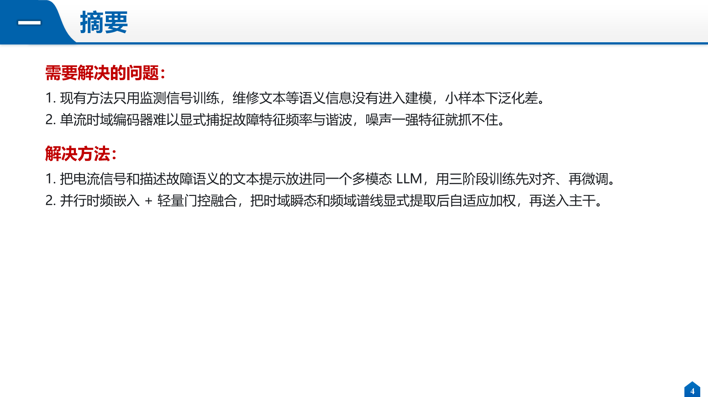 | 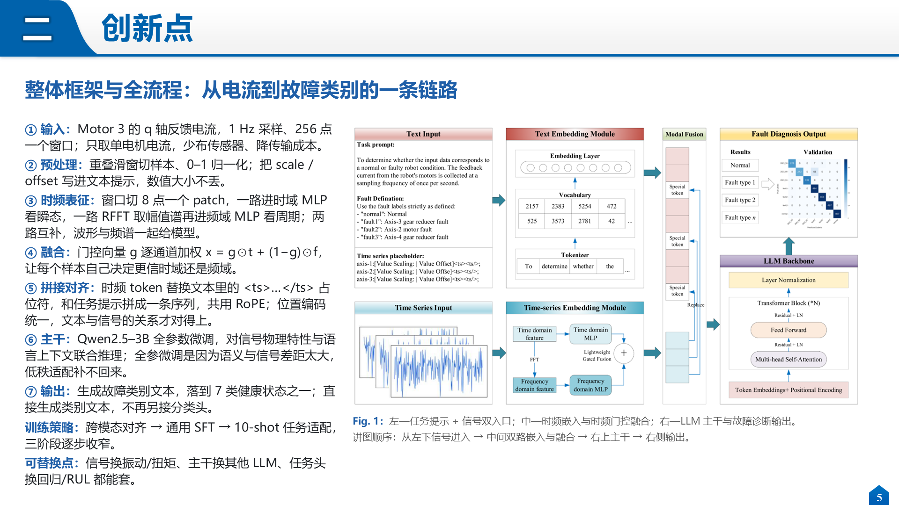 |
| **Novelty (highlighted labels + cropped figure)** | **Comparison experiment** |
| 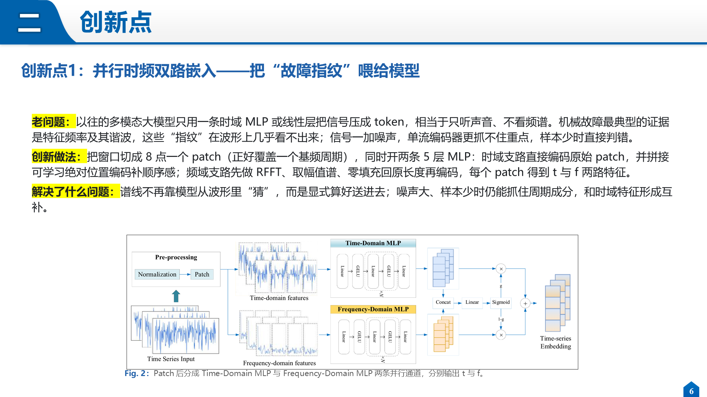 | 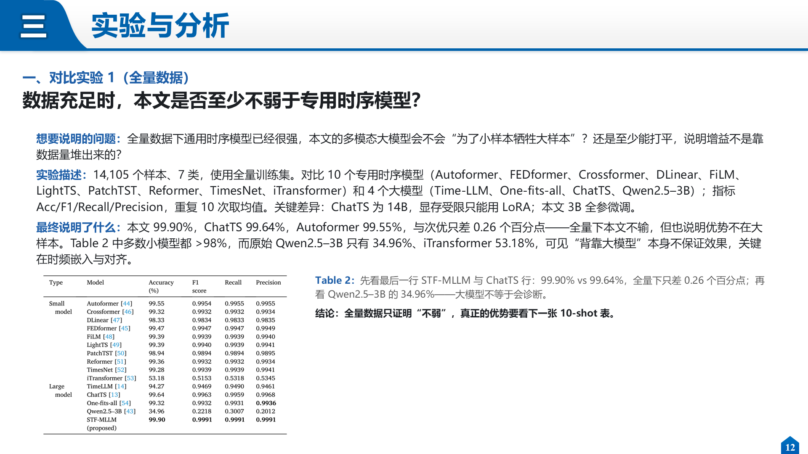 |
| **Conclusion** | |
| 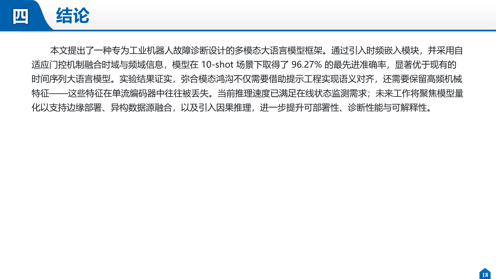 | |

### Second example: FD-LLM (different paper, different deck)

**“Large language models for explainable fault diagnosis of machines”**
(*Engineering Applications of Artificial Intelligence*, 163 (2026) 113131,
DOI: [10.1016/j.engappai.2025.113131](https://doi.org/10.1016/j.engappai.2025.113131)).
This time the user's own old deck was used as the template (after `adapt_template.py` labelled the roles), 19 slides:

| Cover (centred Chinese title, presenter aligned to icons) | Full pipeline |
|---|---|
| 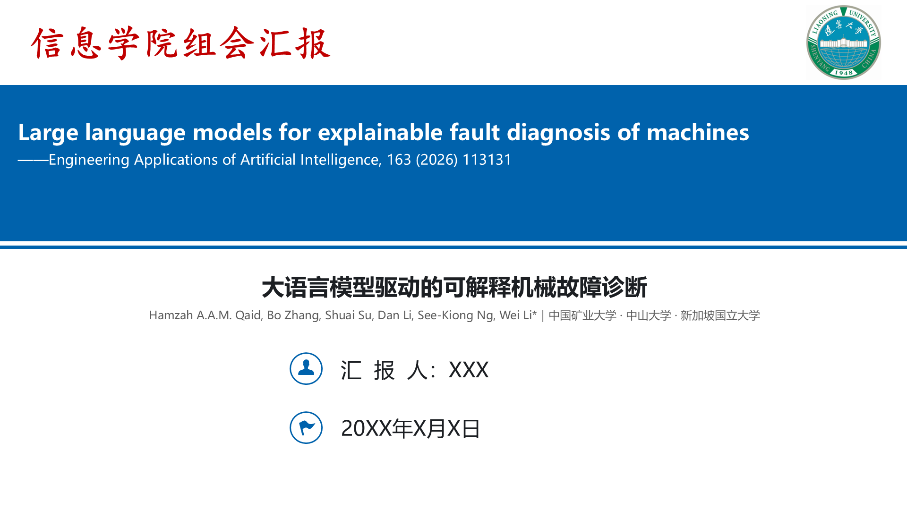 | 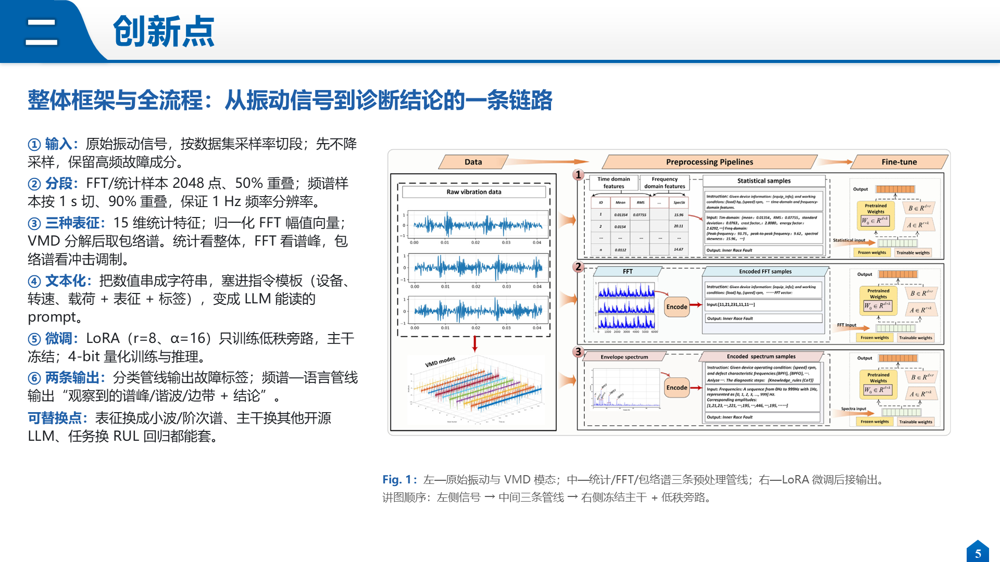 |
| **Ablation 1 (input representation: stats / FFT / envelope spectrum)** | **Explainability (RAGAS + case study)** |
| 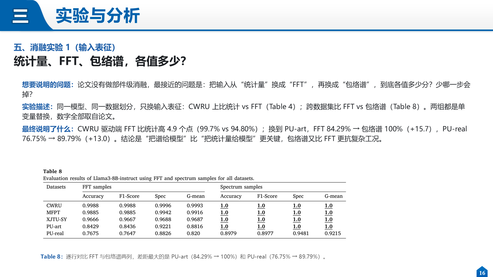 | 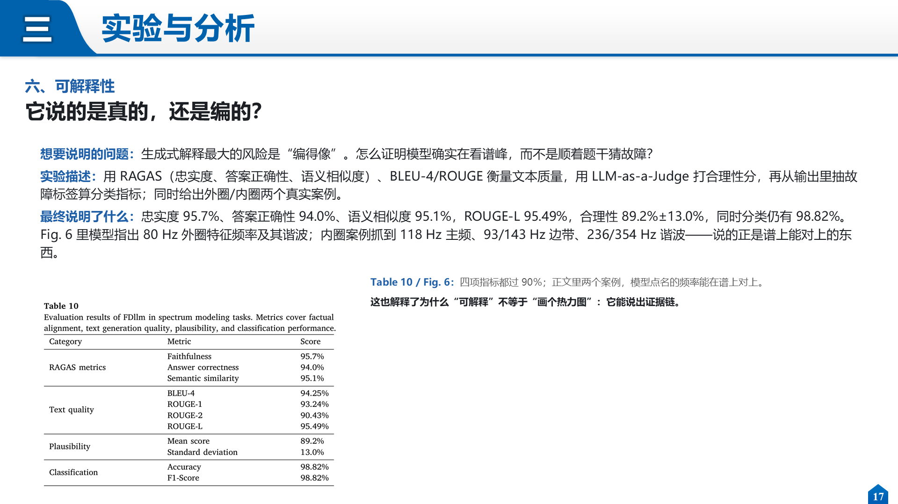 |

The paper has no component-level ablation, so the deck states that explicitly and substitutes an equivalent
single-variable comparison (input representation), with every number taken from Table 4 / Table 8.

## 🎨 Bundled template

`assets/template.pptx` is a **sanitized blank deck** (18 slides) you can use directly or replace with your own:

| Where | Content |
|---|---|
| Cover | `Paper Title in English` / `——Journal / Conference, Year` / `论文中文题目` / `汇  报 人：XXX` / `20XX年X月X日` |
| Slide 2 | Outline (abstract / novelty / experiments / conclusion) |
| Slide 3 | Abstract only |
| Slide 4 | Problems / solutions: red subheads + black body |
| Slides 5–18 | Headers, colors and page numbers kept; body text replaced by “(fill in here)” hints; **all paper figures removed** |

To use your own style, swap `assets/template.pptx` for your last deck.

**Someone else's deck works too.** Shape names differ wildly (`Title 1`, `Rectangle 12`, `TextBox 3`), so let the
adapter label the roles first:

```bash
python scripts/adapt_template.py their_deck.pptx -o tpl_map.json -m tpl_map.md
```

It infers `title / subtitle / body / caption / picture / page_no` from **position + font size + placeholder type + area**
and writes a JSON map:

```json
{"index": 3, "layout": "1_标题和内容",
 "shapes": [{"name": "标题 11", "role": "title", "box": [1.41, 0.1, 11.61, 0.6], "font": 28},
            {"name": "文本框 4", "role": "body", "box": [0.92, 1.7, 11.3, 4.8], "font": 17}]}
```

Build scripts then address shapes by role instead of by name; if something is misclassified, edit the role in the
JSON — no code changes needed.

> The header “信息学院组会汇报” and the university logo on the cover belong to the original author's school —
> replace or remove them before publishing.

## 🛠️ Building the pptx

```bash
# 1) Crop figures/tables by caption (400 dpi)
python scripts/pdf_figs.py paper.pdf -o figs \
    fig1="Fig. 1" fig2="Fig. 2" tab2="Table 2" tab5="Table 5"

# 2) Adapt the template: label title / body / caption / picture slots (required for someone else's deck)
python scripts/adapt_template.py last_talk.pptx -o tpl_map.json -m tpl_map.md

# 3) Full shape dump when you need every coordinate
python scripts/inspect_template.py last_talk.pptx -o tpl.txt
```

Then write a `build_deck.py` (~100 lines; see `references/template-mapping.md`):

```python
import sys
sys.path.insert(0, "<skill>/scripts")
from deckkit import Deck

d = Deck("last_talk.pptx", "new_talk.pptx")
S = list(d.slides)

flow = d.dup(S[3])                 # duplicate a text page for the framework slide
d.drop(flow, "文本框 4")
tf = d.setup(flow, "文本框 2", 0.38, 0.9, 12.5, 0.8)
d.para(tf, [("一、整体框架与全流程：先看全貌", {"bold": True})], first=True, size=20)
d.pic(flow, "figs/fig1.png", 5.35, 1.55, w=7.6)

d.delete(S[9]); d.reorder([...])
d.save()
```

## 🗂️ Repository layout

```
group-meeting-presentation-ppt/
├── SKILL.md                      # rules for the five modules + pptx pipeline
├── README.md                     # Chinese
├── README.en.md                  # English
├── LICENSE
├── assets/
│   └── template.pptx             # blank template
├── docs/
│   ├── example/                  # example slides (cover/abstract/framework/novelty/experiment/conclusion)
│   └── wechat-qr.png             # WeChat QR for feedback
├── references/
│   └── template-mapping.md       # full template workflow, page budget, pitfalls
└── scripts/
    ├── deckkit.py                # slide duplication / text / pictures / reorder
    ├── pdf_figs.py               # caption-driven figure & table cropping
    ├── adapt_template.py         # infer title/body/caption/picture roles for any deck
    └── inspect_template.py       # dump page order, shape names, coordinates
```

## 🧰 Scripts

### 📄 `pdf_figs.py`

```bash
python scripts/pdf_figs.py paper.pdf -o figs fig1="Fig. 1" tab3="Table 3"
```

- Caption below figure → crop the nearest image/drawing area above it;
- Caption above table → use horizontal rules (`drawings`) as bounds, so spanning tables come out whole;
- Everything is rendered with `get_pixmap`: text in figures is usually vector, extracting embedded bitmaps yields empty boxes;
- Outputs `name.png` at 400 dpi.

### 🧱 `deckkit.py`

| Method | Purpose |
|---|---|
| `dup(slide)` | Duplicate a slide with all shapes and formatting |
| `delete(slide)` / `reorder([...])` | Delete / reorder slides |
| `drop(slide, "图片 7")` | Delete a shape by name |
| `setup(slide, name, l, t, w, h)` | Position and clear an existing shape |
| `para(tf, runs, ...)` | Write paragraphs, bold/highlight/indent, sets `lang="zh-CN"` |
| `pic(slide, path, l, t, w/h)` | Insert a picture |

### 🧭 `adapt_template.py` (use it with someone else's deck)

```bash
python scripts/adapt_template.py their_deck.pptx -o tpl_map.json -m tpl_map.md
```

No need to know shape names; roles are inferred from position, font size, placeholder type and area:

| role | Heuristic |
|---|---|
| `title` | title placeholder (idx 0) → name contains “标题/Title” → top-area large text (cover: max font×width; content: max font) |
| `subtitle` | large text on the cover besides the title (subtitle, presenter, date) |
| `body` | largest remaining text box |
| `caption` | lower-half text with font ≤16 (usually a “Fig. X …” note) |
| `picture` | all picture shapes |
| `page_no` / `header` | page-number placeholder, running header |

Fix misclassifications by editing `role` in the JSON — no code change needed.

### 🔍 `inspect_template.py`

```bash
python scripts/inspect_template.py template.pptx -o tpl.txt
```

Prints each slide's layout name, shape names, `L/T/W/H` (inches) and text — use it to decide which page to reuse
and which box to rewrite.

## 📌 Conventions

- **Ask the user first** which language each of abstract and conclusion should use (Chinese or English, independently), plus presenter and date — never assume.
- **Left-align Chinese text**: justified text pushes punctuation to line starts and stretches spacing. Add `lang="zh-CN"` to runs.
- **Novelty slides are plain-language explanations** (2–3 sentences each) next to the method figure; split the slide rather than shrinking the font.
- **The full-pipeline framework slide comes first**, numbered 一, novelties follow as 二~五.
- **Experiment slides must match the figures/tables**: sample size, baseline configuration gaps, numbers from the paper, and a reading of the figure.
- **Numbers must come from the paper** — no estimates, no invention. If something is missing, write “not reported”.

## ❓ FAQ

**My model can't see images — can I still use it?**
Yes, with a caveat. Markdown, cropping, templating and export all work; the difference is that **it cannot see inside the figures** — where the confusion matrix errs, whether curves converge, which block of the method figure is which. It will say “I can't see that figure” instead of inventing a conclusion. Fix: use a multimodal model for the content pass, or send key figures to a vision model and paste the answers back.

**My field has no dataset — what then?**
Skip the dataset slide. The mandatory “experimental setup” slide covers splits, hyperparameters, training strategy and metrics. The skill never fabricates data.

**I don't have a previous deck.**
Use the bundled `assets/template.pptx`, or let the skill design from scratch (optionally with `ppt-master`-style tools).

**The cropped table is missing its right-hand columns.**
A reference sentence in the body text was probably mistaken for the caption. `pdf_figs.py` already filters long sentences; if it still fails, specify the crop area manually.

**Pictures disappear after duplicating a slide.**
`deepcopy` copies XML but not image relationships. Drop the old picture and re-insert it with `add_picture`.

**Chinese punctuation jumps to the start of lines / spacing looks stretched.**
That is justified alignment. Switch to left alignment and ensure runs carry `lang="zh-CN"`.

**Exported PNGs don't match what PowerPoint shows.**
Prefer PowerPoint COM export (`Slide.Export`) — it matches the real render most closely.

## 💬 Feedback

Bugs, new template layouts, or rules for your own field — just ping me:

<p align="center">
  
  <br>
  <sub>Scan to add me on WeChat, mention “group-meeting PPT”</sub>
</p>

Issues are welcome too. Please include: paper type (dataset or not), what you want changed, and screenshots.

## ⭐ Star this repo

If this skill saved you the hours of translating, cropping and laying out:

- Hit **⭐ Star** at the top right, so more students buried in group meetings can find it;
- Forward it to the labmate who pulls an all-nighter before every talk;
- PR your own template or field-specific rules back — let's grow the template library together.

A star costs nothing, but it means a lot to a personal project. Thank you!

## 📜 License

© 辽大TJ

## ⚠️ Disclaimer

- This skill automates **formatting and layout only**. It does not replace reading the paper — verify the content yourself.
- Figures and tables in papers remain the copyright of their authors and publishers; cite them properly when sharing publicly.
