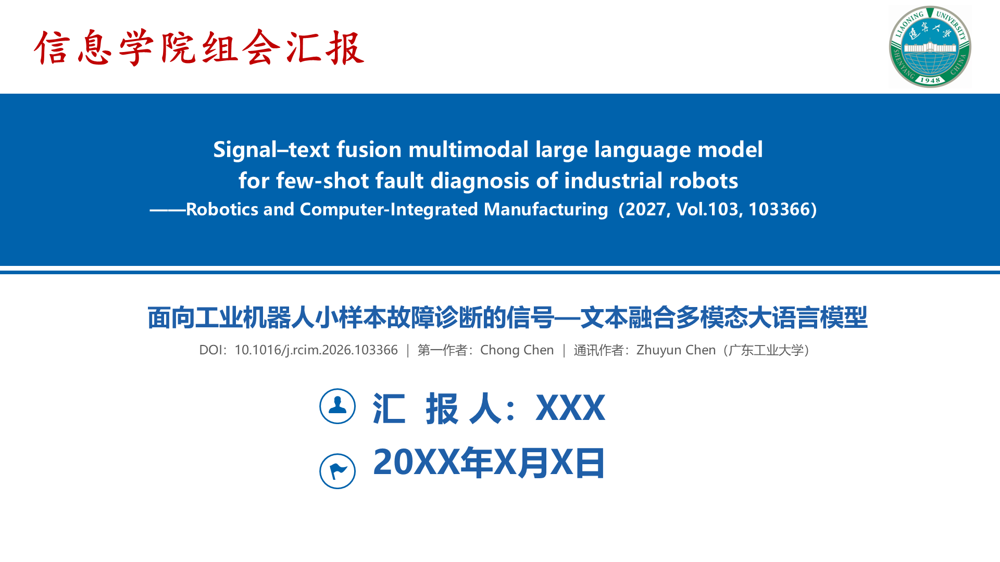
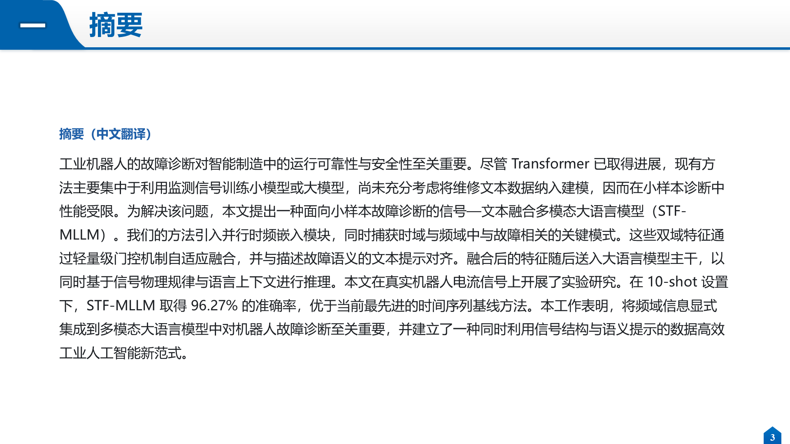
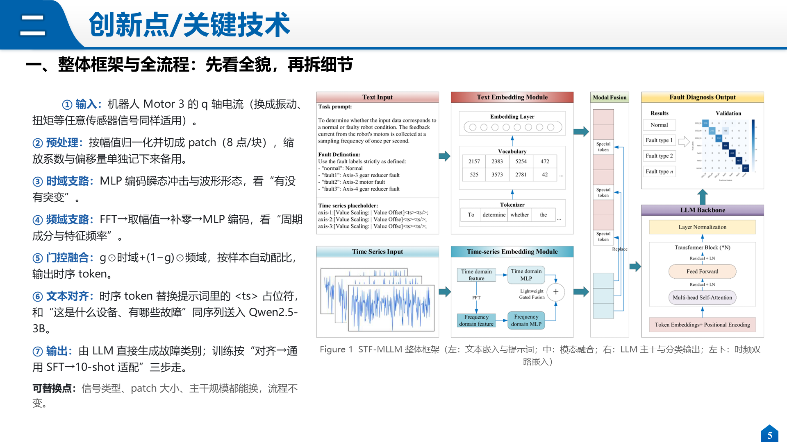
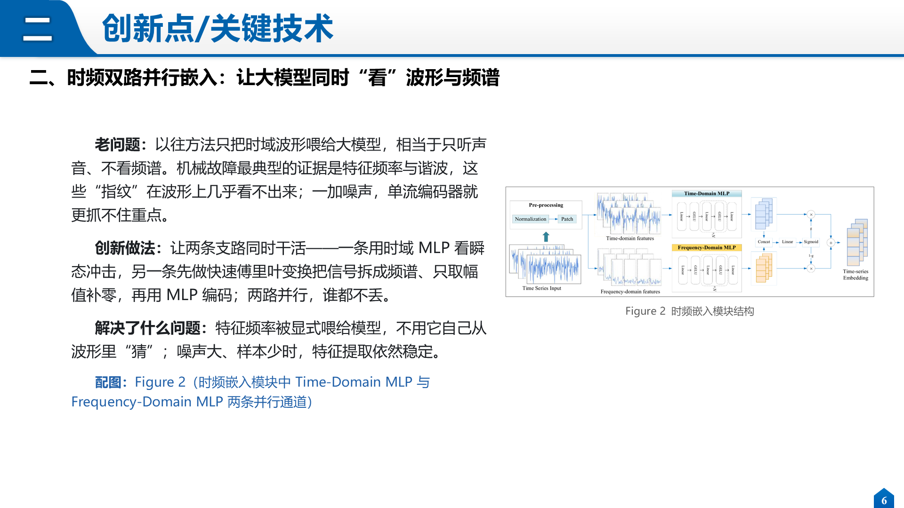
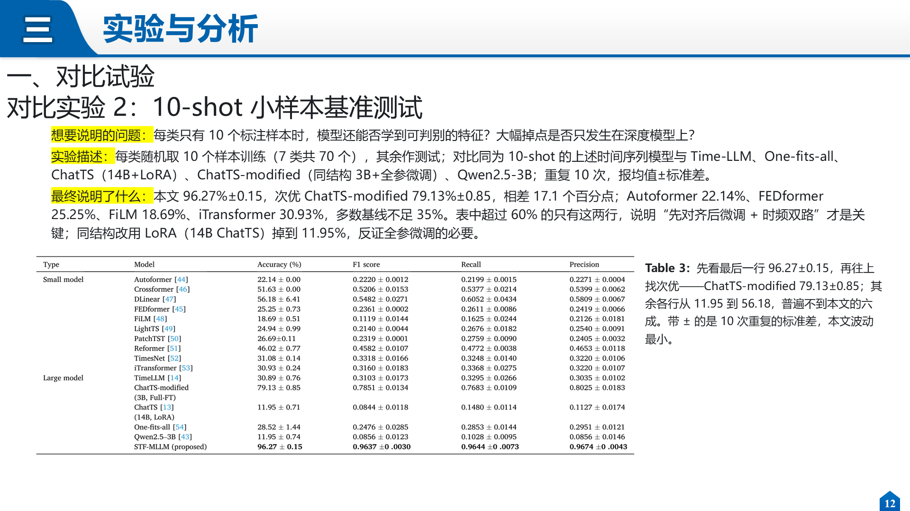
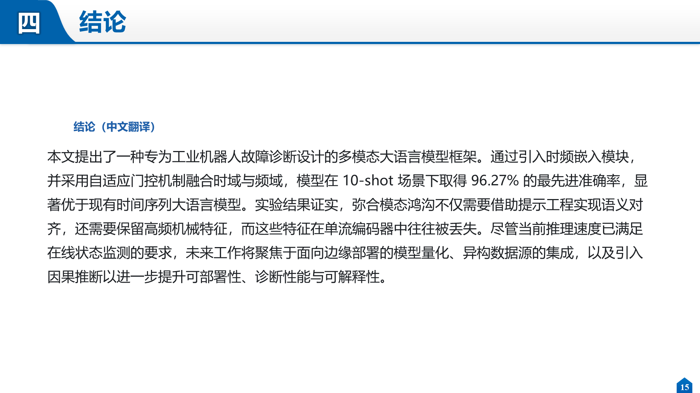

# Group meeting presentation-PPT

[简体中文](README.md) | [English](README.en.md)

> **辽大的同学们，你还在为组会汇报发愁吗？**
> 每周轮到你讲 paper，读完原文还要翻译、抠图、排版、对齐上次的风格，一页一页抠到凌晨——
> 这个 skill 就是把这套重复劳动压成一句话的事。

把一篇论文自动整理成**中文组会汇报稿**，并可直接套用你上一次汇报的 PPT 模板生成 `.pptx`。
不管是机械、材料、医学还是文史哲，组会要讲的都是同样的几件事，模板和规则不用改。

一个 **Agent Skill**（`SKILL.md` 规范）：给定论文 PDF、DOI 或原文，按固定的五模块产出中文汇报内容；
需要成品时，再复用你的 deck 版式生成幻灯片，图、表从 PDF 里自动裁切。

不绑定单一客户端——**Claude Code、opencode、DeepSeek Harness、豆包、Codex 等支持 `SKILL.md` 的智能体都能直接用**，
脚本本身是纯 Python，脱离任何智能体也能手动跑。

> 如果这个 skill 帮你省下了一个晚上，**点个 ⭐ Star** 就是最好的支持。

---

## 🎯 它解决什么问题

组会讲 paper，通常要在 **10–15 页**里讲清五件事：这是篇什么文章、摘要说了啥、创新在哪、实验怎么做的、结论是什么。
手工做一轮往往要 2–3 小时：读原文、翻译、抠图、排版、对齐上次的风格。

这个 skill 把流程固定下来：

1. 📝 **内容**：按五模块产出中文稿（`## 模块X：…` 为页标题），可直接粘进 PPT；
2. 🖼️ **配图**：按 `Fig. 2` / `Table 5` 从 PDF 自动裁 400dpi 图片；
3. 🎨 **版式**：复制你上次汇报的 deck，只改字、换图、重排，风格保持一致；
4. 🔍 **自检**：导出每页 PNG 逐页检查溢出、压字、残留旧文字。

## ✨ 特性

- 🧩 **五模块固定输出**：基本信息 / 摘要 / 创新点 / 实验 / 结论，编号连续、不跑题。
- 💡 **创新点只讲思想**：老问题 → 创新做法 → 解决了什么 → 配图，四要素齐全，禁止混入实验数字。
- 🧭 **框架图必须讲全流程**：作为创新点第一页，按「输入 → 预处理 → 特征 → 融合 → 主干 → 输出」走一遍，并点出可替换点。
- 📊 **实验写到能对上图表**：点名最高/最低、差多少、错分在哪两类，而不是“效果很好”。
- 🔀 **摘要、结论语言可选**：中文或英文，两处可以不一样（共 4 种组合）。
- 🚫 **不硬凑数据集**：没有数据集的方向（纯理论、纯仿真、算法框架类）自动跳过数据集页，改由「实验设置」页交代复现条件。
- 🎨 **可复用已有模板**：用 `deckkit` 复制页、改字、换图、重排，继承你原来的配色与页眉。
- 🎛️ **别人的模板也能适配**：`adapt_template.py` 自动识别标题/正文/图注/图片位，换谁的 deck 都不用重写脚本。
- 🖼️ **图/表自动裁切**：`pdf_figs.py` 用表格横线定表边界，跨栏大表也能裁全。
- 🎓 **什么专业都能用**：例子只是格式示范，术语、指标、数据集按手上的论文替换。

## 📦 安装

核心只有一个目录：把整个仓库放进你所用的智能体的 skills 目录，**目录名与 `SKILL.md` 里的 `name` 保持一致**即可。

```bash
# macOS / Linux（Claude Code、opencode 等默认读这里）
git clone <this-repo> ~/.claude/skills/group-meeting-presentation-ppt

# Windows
git clone <this-repo> %USERPROFILE%\.claude\skills\group-meeting-presentation-ppt
```

不同客户端的 skills 目录可能不同：DeepSeek Harness / 豆包 / Codex 等若支持 `SKILL.md`，
按其文档把本目录放进对应的 skills（或插件/技能）路径即可，文件本身不用改。
也可以只当脚本库用：

```bash
git clone <this-repo>
cd group-meeting-presentation-ppt
python scripts/adapt_template.py 模板.pptx -o tpl_map.json   # 不依赖任何智能体
```

依赖（仅生成 pptx 时需要）：

```bash
pip install python-pptx PyMuPDF lxml
```

> 导出 PNG 自检用 PowerPoint COM（Windows）或 LibreOffice（跨平台），非必需。

**环境**：已在 Windows 10/11 + Python 3.12 + `python-pptx 1.0` + `PyMuPDF 1.24` 上测试；
`pdf_figs.py` / `adapt_template.py` / `inspect_template.py` 跨平台可用，只有“导出 PNG 校验”这一步在 Windows 下最方便。

## 🚀 快速开始

不用记命令，也不用背参数——**打开对话，把论文丢进去，用人话提要求**就行。

### 第 1 步：把论文给它

支持三种给法，任选其一：

- **拖文件**：把 PDF 直接拖进对话框（Claude Code、opencode 都支持）
- **给路径 / 链接**：`D:\papers\xxx.pdf`、DOI `10.1016/j.rcim.2026.103366`、arXiv 链接
- **贴原文**：直接把 Abstract / 正文粘进去（没 PDF 就裁不了图）

### 第 2 步：一句话说清要什么

```
帮我做这篇 paper 的组会汇报，按通用文献阅读模板
<把你的 PDF 拖进来>
汇报人：张三
日期：2026年11月9日
摘要中文，结论中文
用 assets/template.pptx 套版式
```

少写几句也能跑，缺的信息它会问：

| 你没说 | 它会问 |
|---|---|
| 摘要/结论语言 | 中文还是英文？两处可以不一样（中中 / 英英 / 中英 / 英中） |
| 汇报人 | 封面写谁的名字？ |
| 日期 | 哪天汇报？ |
| 模板 | 用自带的 `assets/template.pptx`，还是你上次的 deck？ |

### 第 3 步：看它交付什么

- **只要文字稿**：说「先给我 Markdown 稿」，得到 `paper_文献阅读汇报稿.md`（五模块，分页写，可直接粘进 PPT）
- **要成品**：加一句「套模板生成 pptx」，它会裁图（400dpi）→ 认模板 → 复制页改字 → 导出每页 PNG 自查，最后给你 `YYYY.MM.DD_论文简称组会汇报.pptx`

### 第 4 步：不满意就直接说

改起来不需要懂代码，继续说人话即可：

```
创新点第三条再白话一点，现在太像摘要
实验页把 Table 3 放上去，右下角图注写"怎么看"
封面日期改成 2026年11月16日
这页太挤了，拆成两页
```

也可以只跑脚本、完全不进对话：

```bash
python scripts/pdf_figs.py paper.pdf -o figs fig1="Fig. 1" tab2="Table 2"
python scripts/adapt_template.py 我的模板.pptx -o tpl_map.json
```

## 🧩 输出的五个模块

| 模块 | 内容 | 要点 |
|---|---|---|
| 1 论文基本信息 | 题目 / 作者单位 / 期刊卷期 / DOI / 汇报人 / 日期 | 封面页 |
| 2 摘要 | 中文翻译或英文原文（用户选）+ 需要解决的问题 2 条 + 解决方法 2 条 | 忠实原文，不改写 |
| 3 创新点 | **整体框架全流程 1 页** + 2–4 条创新点 | 只讲思想，不写实验数字 |
| 4 实验 | 数据集（**可选**）→ **实验设置（固定 1 页）** → 对比实验 → 消融实验 | 每组四要素，数值对得上表 |
| 5 结论 | 中文翻译（或原文） | 逐句忠实 |

创新点每条的写法：

```
老问题：原方法怎么做、卡在哪、后果是什么（可用类比）
创新做法：做了什么 + 一句白话解释机制
解决了什么问题：对上面缺陷的直接改善
配图：Figure X（图里哪一块）
```

**关于数据集页**：有自建/公开数据集的论文（故障诊断、图像、遥感、材料表征…）单独上 1 页；
纯理论推导、纯仿真、算法与框架类、人文社科等**没有数据集这一环的方向，直接跳过这一页**，不要为凑版式编造。
**「实验设置」页固定保留**：数据划分、关键超参、训练策略、评价指标与软硬件，不管有没有数据集页都写，听众能据此判断结果可不可信。

## 🖼️ 示例效果

以 **《Signal–text fusion multimodal large language model for few-shot fault diagnosis of industrial robots》** 论文为例
（*Robotics and Computer-Integrated Manufacturing*, 2027, 103: 103366，DOI: [10.1016/j.rcim.2026.103366](https://doi.org/10.1016/j.rcim.2026.103366)），
下面 6 页全部由本 skill 生成（汇报人与日期按占位符显示）：

| 封面 | 摘要 |
|---|---|
|  |  |
| **整体框架与全流程（创新点第一页）** | **创新点（白话解释 + 方法图局部）** |
|  |  |
| **对比实验（数值 + 读图结论）** | **结论** |
|  |  |

## 🎨 自带模板 `assets/template.pptx`

仓库里放了一份**脱敏后的空白模板**（17 页版式，直接可用，也可以换成你自己的 deck）：

| 位置 | 内容 |
|---|---|
| 封面 | `Paper Title in English` / `——Journal / Conference, Year` / `论文中文题目` / `汇  报 人：XXX` / `20XX年X月X日` |
| 第 2 页 | 提纲（摘要 / 创新点 / 实验与分析 / 结论） |
| 第 3–17 页 | 各页保留页眉、配色、页码，正文换成「（此处填写：…）」提示，**原论文插图已清除** |

替换成自己的风格：把 `assets/template.pptx` 换成你上次汇报的 deck 即可。

**别人的模板也能用**。不同人的 deck 形状名千差万别（`Title 1`、`Rectangle 12`、`TextBox 3`），
所以先跑一遍角色识别，把「哪个框是标题 / 正文 / 图注 / 图片位」自动标出来：

```bash
python scripts/adapt_template.py 别人模板.pptx -o tpl_map.json -m tpl_map.md
```

它按**位置 + 字号 + 占位符类型 + 面积**判断角色，输出的 JSON 每页长这样：

```json
{"index": 3, "layout": "1_标题和内容",
 "shapes": [{"name": "标题 11", "role": "title", "box": [1.41, 0.1, 11.61, 0.6], "font": 28},
            {"name": "文本框 4", "role": "body", "box": [0.92, 1.7, 11.3, 4.8], "font": 17}]}
```

build 脚本按 `role` 取名字，就不会因为换了套模板而全盘重写；个别判错直接改 JSON 里的 role，不用改代码。

> 封面左上角「信息学院组会汇报」与右上角校徽属于原作者所在学校，公开仓库使用前请自行替换或删除。

## 🛠️ 生成 pptx（套用自己的模板）

```bash
# 1) 按图注裁图（400dpi）
python scripts/pdf_figs.py paper.pdf -o figs \
    fig1="Fig. 1" fig2="Fig. 2" tab2="Table 2" tab5="Table 5"

# 2) 认模板：自动标出标题 / 正文 / 图注 / 图片位（换别人的 deck 时必做）
python scripts/adapt_template.py 上次汇报.pptx -o tpl_map.json -m tpl_map.md

# 3) 需要全部形状明细时再看一眼
python scripts/inspect_template.py 上次汇报.pptx -o tpl.txt
```

然后写一个 `build_deck.py`（约 100 行，模板见 `references/template-mapping.md`）：

```python
import sys
sys.path.insert(0, "<skill>/scripts")
from deckkit import Deck

d = Deck("上次汇报.pptx", "新汇报.pptx")
S = list(d.slides)

flow = d.dup(S[3])                 # 复制一页“文字页”当框架全流程页
d.drop(flow, "文本框 4")            # 按形状名删/换
tf = d.setup(flow, "文本框 2", 0.38, 0.9, 12.5, 0.8)
d.para(tf, [("一、整体框架与全流程：先看全貌", {"bold": True})], first=True, size=20)
d.pic(flow, "figs/fig1.png", 5.35, 1.55, w=7.6)

d.delete(S[9]); d.reorder([...])   # 删多余页、重排
d.save()
```

## 🗂️ 目录结构

```
group-meeting-presentation-ppt/
├── SKILL.md                      # 主文件：五模块规则 + 生成 PPTX 流程
├── README.md
├── README.en.md                  # English
├── LICENSE
├── assets/
│   └── template.pptx             # 空白模板
├── docs/
│   ├── example/                  # 示例汇报截图（封面/摘要/框架/创新点/实验/结论）
│   └── wechat-qr.png             # 反馈用微信二维码
├── references/
│   └── template-mapping.md       # 套模板完整流程、页数配比、踩坑清单
└── scripts/
    ├── deckkit.py                # 模板复用库：复制页/改字/插图/重排
    ├── pdf_figs.py               # 按 Fig./Table 图注自动裁切
    ├── adapt_template.py         # 自动识别任意模板的 title/body/caption/picture 角色
    └── inspect_template.py       # 盘点 deck 页序、形状名、坐标
```

## 🧰 脚本说明

### 📄 `pdf_figs.py`

```bash
python scripts/pdf_figs.py paper.pdf -o figs fig1="Fig. 1" tab3="Table 3"
```

- 图注在图下方 → 取图注上方最近的图像/绘图区域；
- 表注在表上方 → 用表格横线（drawings）定边界，跨栏表也裁全；
- 统一按区域 `get_pixmap` 渲染：论文图上的文字多为矢量，直接抽内嵌位图会得到“空框”；
- 输出 `name.png`，默认 400 dpi。

### 🧱 `deckkit.py`

| 方法 | 作用 |
|---|---|
| `dup(slide)` | 复制一页（含全部形状与格式） |
| `delete(slide)` / `reorder([...])` | 删页 / 按对象顺序重排 |
| `drop(slide, "图片 7")` | 按形状名删除 |
| `setup(slide, name, l, t, w, h)` | 定位并清空已有形状 |
| `para(tf, runs, ...)` | 分段写字，支持加粗/高亮/首行缩进，自动加 `lang="zh-CN"` |
| `pic(slide, path, l, t, w/h)` | 插图 |

### 🧭 `adapt_template.py`（换别人的模板时用）

```bash
python scripts/adapt_template.py 别人模板.pptx -o tpl_map.json -m tpl_map.md
```

不用管形状叫什么名字，脚本按「位置 + 字号 + 占位符类型 + 面积」判角色：

| role | 判据 |
|---|---|
| `title` | 标题占位符（idx 0）→ 名字含“标题/Title”→ 顶部大字（封面取字号×宽度最大，正文页取字号最大） |
| `subtitle` | 封面除标题外的大字（副标题、汇报人、日期） |
| `body` | 剩余文本框中面积最大的一个 |
| `caption` | 下半页、字号 ≤16 的次大文本（多为“图 X …”说明） |
| `picture` | 所有图片形状 |
| `page_no` / `header` | 页码占位符、页眉条 |

判错就改 JSON 里的 `role`，不必改脚本；build 脚本按 role 取名，换模板时改动量最小。

### 🔍 `inspect_template.py`

```bash
python scripts/inspect_template.py 模板.pptx -o tpl.txt
```

输出每页的版式名、形状名、`L/T/W/H`（英寸）与文字，用来确定复用哪页、改哪个框。

## 📌 约定与细节

- **摘要、结论的语言先问用户**：中文还是英文、两处是否一致，不擅自决定。
- **汇报人、日期由用户输入**：不沿用模板旧名、不用默认今天。
- **中文一律左对齐**：两端对齐会把 `，。` 顶到行首、中英文之间拉开空隙；并给 run 加 `lang="zh-CN"`。
- **创新点页文字是白话解释**（各 2–3 句），右侧配方法图；放不下就拆页，别缩字号。
- **框架全流程页放在创新点第一页**，编号「一」，创新点顺延二~五。
- **实验页要能对上图表**：写样本规模、对比组配置差异、原文数值与读图结论。
- **数值必须来自原文**，不估算、不编造；论文没给就写“原文未给出”。

## ❓ 常见问题

**Q：我的方向没有数据集怎么办？**
A：直接跳过数据集页，由「实验设置」页交代数据划分、超参、训练策略和指标即可；skill 不会为此编造数据。

**Q：我没有现成的 PPT 模板怎么办？**
A：用仓库自带的 `assets/template.pptx`，或让 skill 从零设计（也可配合 `ppt-master` 类工具）。

**Q：裁出来的表格缺了右边几列？**
A：多半是图注被正文引用句误判。`pdf_figs.py` 已过滤长句，仍失败时手动指定裁剪区域，或在该页先确认表注位置。

**Q：复制页后图片不见了？**
A：`deepcopy` 只搬 XML，图片关系没跟过去。复制页里的旧图要先 `drop`，再用 `add_picture` 重新插入。

**Q：中文标点跑到行首、字间距被拉大？**
A：用了两端对齐。改成左对齐，并确保 run 带 `lang="zh-CN"`。

**Q：导出的 PNG 和放映效果不一致？**
A：优先用 PowerPoint COM 导出（`Slide.Export`），最接近真实渲染。

## 💬 反馈与交流

用着不顺手、想要新的模板版式、或者想加自己领域的规则，都欢迎直接找我：

<p align="center">
  
  <br>
  <sub>扫码添加微信，备注「组会 PPT」</sub>
</p>

提 issue 也可以，请尽量带上：论文类型（有没有数据集）、你希望怎么改、以及截图。

## ⭐ 点个 Star 吧

如果这个 skill 帮你省下了翻译、抠图、排版的那几个小时：

- 右上角点个 **⭐ Star**，让更多被组会支配的同学刷到它；
- 顺手转发给实验室群里那个每次汇报都通宵的师弟师妹；
- 用出了新模板、新领域的写法，欢迎 PR 回来，大家一起把模板库养厚。

Star 不花钱，但对个人项目是最大的鼓励 —— 谢谢！

## 📜 License

© 辽大TJ

## ⚠️ 声明

- 本 skill 只做**格式与排版自动化**，不替代对论文的理解；汇报内容需自己核对。
- 论文的图、表版权归原作者与出版方所有，公开分享时请注意引用规范。
